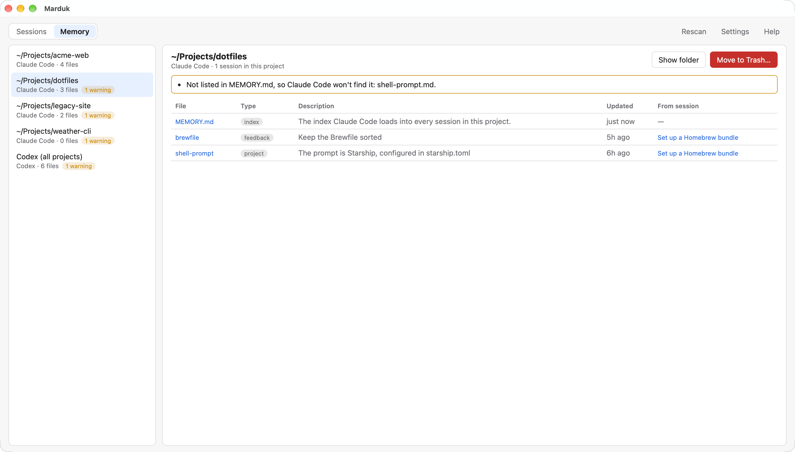
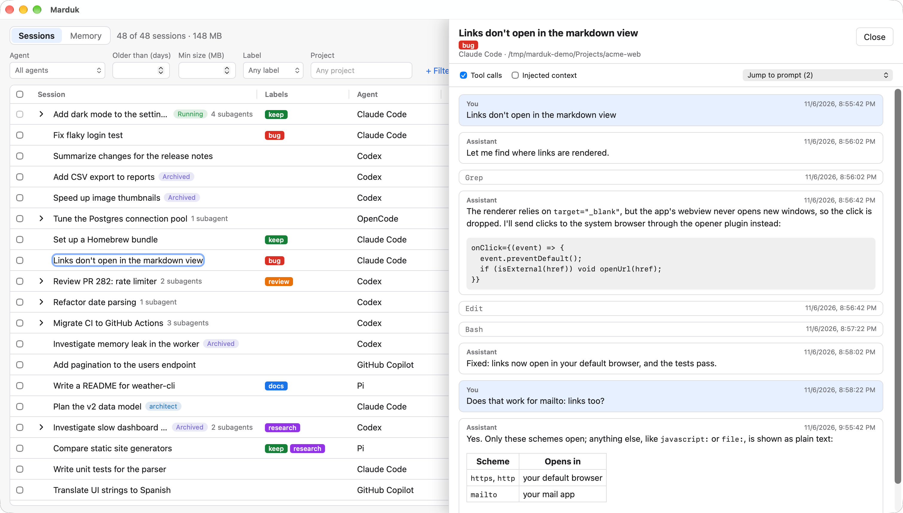

# Marduk


In the Babylonian creation epic, the _Enūma Eliš_, the world begins as Tiamat, the primordial salt sea, mingled with Apsu, the fresh water. When the younger gods kill Apsu, Tiamat raises an army of monsters against them, and none of the gods will face her until Marduk agrees to, on the condition that he rule them if he wins. He catches Tiamat in his net, drives the winds into her and splits her with an arrow. Then he puts the pieces in order: half of her becomes the sky and half the earth, and he gives the stars their stations and the year its months. His symbol is the _marru_, a spade, which is what he's holding above. (His name is pronounced MAR-dook, with the vowel of "book", not "duck".)

Your coding agents are less monstrous than Tiamat, but left alone they make their own kind of chaos: thousands of sessions spread across Claude Code, Codex, OpenCode and the rest, each stored in its own format and folder, most of which nobody will open again. Marduk is a cross-platform desktop app that puts them in order. It finds every agent's sessions, shows them in one list, and helps you clean up the ones you no longer need.

It reads the transcripts that coding agents keep on disk. You can filter by agent, age, size or project, then delete the sessions you don't need, or archive them when the agent supports archiving.


## Supported agents

| Agent                        | Location                                                                                                                                   | Delete                                                                                                                                                                                                  | Archive                                                          |
| ---------------------------- | ------------------------------------------------------------------------------------------------------------------------------------------ | ------------------------------------------------------------------------------------------------------------------------------------------------------------------------------------------------------- | ---------------------------------------------------------------- |
| Claude Code                  | `~/.claude/projects` (or `$CLAUDE_CONFIG_DIR/projects`)                                                                                    | Moves the transcript, its `<id>.*` sidecar files and its `<id>/` folder (subagents, tool results) to the Trash                                                                                          | —                                                                |
| Codex                        | `~/.codex/sessions` and `~/.codex/archived_sessions` (or `$CODEX_HOME`)                                                                    | **Permanent**, through `codex delete --force <id>`, which also deletes the subagent sessions it spawned (not its Guardian reviews); needs the Codex CLI                                                 | `codex archive` / `codex unarchive`                              |
| GitHub Copilot (CLI and app) | `~/.copilot/session-state/<id>/` (or `$COPILOT_HOME/session-state`)                                                                        | Moves the session folder to the Trash; Copilot's own delete is only in its interactive UI. Run `/chronicle reindex` in Copilot afterwards to update its search index. A copy synced to GitHub.com stays | — (the app's archive is UI-only; the CLI has none)               |
| Copilot Chat (VS Code)       | `<VS Code user folder>/workspaceStorage/<id>/chatSessions/` and `globalStorage/emptyWindowChatSessions/` (also VS Code Insiders, VSCodium) | Moves the chat's `.json`/`.jsonl` file and its edit checkpoints to the Trash. VS Code has no delete command, and its chat history may still list the chat until you use Delete on it in VS Code         | — (VS Code has no chat archive)                                  |
| OpenCode                     | `~/.local/share/opencode/opencode*.db` (or `$XDG_DATA_HOME/opencode`, `$OPENCODE_DB`)                                                      | **Permanent**, through `opencode session delete <id>`, which also deletes the session's child sessions; needs the OpenCode CLI                                                                          | Shows OpenCode's archived state; OpenCode has no archive command |
| Kilo                         | `~/.local/share/kilo/kilo*.db` (or `$XDG_DATA_HOME/kilo`, `$KILO_DB`)                                                                      | **Permanent**, through `kilo session delete <id>`, which also deletes child sessions; needs the Kilo CLI                                                                                                | Shows Kilo's archived state; Kilo has no archive command         |
| Pi                           | `~/.pi/agent/sessions` (or `$PI_CODING_AGENT_DIR/sessions`)                                                                                | Moves the transcript to the Trash                                                                                                                                                                       | —                                                                |

OpenCode and Kilo (an OpenCode fork) keep every session in one SQLite database. Marduk opens it read-only, reads both OpenCode's current (`session_v2`) and older (`session`) tables, and never writes to it. If a session's messages are stored in a shape Marduk doesn't recognize (a newer OpenCode, say), the transcript is read through the agent's export command (`opencode session export`, `kilo export`) instead.

When an agent has its own delete or archive command, Marduk uses it, so the agent's own indexes stay consistent. Otherwise sessions go to the system Trash. Claude Code and Pi have no per-session delete command; Pi's own session picker also uses the Trash.

## Subagent sessions

Sessions an agent started on its own (Codex Guardian reviews and spawned subagents, OpenCode and Kilo child sessions) are nested under the session that started them. Expand a parent to see them. They go with their parent: select the parent to delete it and them. Codex leaves a session's Guardian reviews behind when it deletes the session, so Marduk deletes them too. A subagent whose parent was deleted is shown at the top level with a _Parent deleted_ badge, and can be selected on its own. Claude Code keeps its subagents inside the parent session's folder (`<session>/subagents/`), so they appear under their session titled from their description and agent type, and can be read but not deleted, archived or labeled on their own: deleting the parent moves them to the Trash with it.

## Labels

Select sessions and use **Labels ▾** to add or remove labels, or create a new one by typing its name. Filter by label from the _Label_ dropdown, and rename, recolor or delete labels in **Settings**. Labels are stored by Marduk (in `labels.db` in its app data folder), keyed by agent and session id, so they survive an agent archiving or moving a session. Deleting a session in Marduk removes its labels; labels of sessions deleted some other way are removed after they've been missing from complete scans for 7 days.

## Agent memory

The **Memory** tab shows what agents remember between sessions.



- **Claude Code** keeps memory per project, in `~/.claude/projects/<project>/memory/`: a `MEMORY.md` index that it loads into every session, plus one file per memory. Marduk lists each project's memory files with their type, description and the session that wrote them, and warns when the index is longer than the 200 lines Claude Code loads, when a memory isn't listed in the index, when the index links to a missing file, or when the project folder no longer exists. You can read the files, show the folder, or move a project's memory to the Trash.
- **Codex** keeps one memory store for all projects, in `~/.codex/memories/` (or `memories_v2/`), when its memories feature is on. Codex regenerates these files itself, so Marduk only shows them, and links each session summary to its session. Clear them with Codex's own **Settings › Personalization › Delete Codex memories**.

Deleting sessions doesn't make Claude Code's memory useless: it's per project, and Claude Code uses it again the next time you work there. When a delete removes a project's last session, the confirmation offers to move that project's memory to the Trash too, unchecked by default.

## Reading transcripts



Click a session's title to read it in a side panel. Messages are rendered as Markdown, tool calls are collapsed with their output, and injected context (system prompts, AGENTS.md) is hidden unless you turn it on. Very long sessions show their first and last 500 messages. For Pi, only the active branch is shown, not abandoned rewinds.

## Safety rules

The app explains these too: **Help** has a tab per topic, and an **Agents** tab with how each agent deletes and archives and which folders Marduk reads on your machine.

- **Trash, unless the agent deletes natively.** Sessions without a native delete command go to the system Trash (Recycle Bin on Windows). If that fails, Marduk reports the error rather than deleting permanently. Native deletes that can't be undone (Codex) are labeled _Permanent_ in the confirmation dialog, which also shows the exact command.
- **Running sessions are never changed.** A session whose transcript changed in the last 5 minutes is marked _Running_ and can't be deleted or archived.
- **Changed since scan is refused.** If a transcript's size or modification time changed after the scan, Marduk refuses to delete it and asks you to rescan.
- **Confined to agent folders.** Every path is resolved (following `..` and symlinks) and must sit inside the agent's session folder.
- **Agent databases are never written to.** For agents that keep sessions in a database, Marduk will only delete through the agent's own CLI.
- **No invented archives.** Marduk only archives through an agent's own archive command, and doesn't create archive folders that agents don't know about.
- **Agent CLIs are found outside your shell too.** Apps opened from the Dock don't get your shell's `PATH`, so Marduk also looks in `~/.local/bin`, Homebrew and other common install folders. If yours is somewhere else, choose it in **Settings → Agent CLIs**, which also shows the version Marduk will run. Marduk never installs or updates agent CLIs itself, because a different version from the agent you use could migrate its data out from under it.

## Development

Requirements: Rust (stable), Node.js 22 and pnpm 10, plus the [Tauri prerequisites](https://tauri.app/start/prerequisites/) for your OS:

- **macOS:** Xcode Command Line Tools (`xcode-select --install`).
- **Windows:** Microsoft C++ Build Tools ("Desktop development with C++") and the WebView2 runtime (already installed on Windows 10 and 11). Use the `x86_64-pc-windows-msvc` Rust toolchain, which is the default from rustup.
- **Linux:** the WebKitGTK and related packages listed on that page.

The repo uses LF line endings on every OS (`.gitattributes`), so Windows checkouts stay byte-for-byte the same as macOS ones.

```sh
pnpm install
pnpm tauri dev                          # run the app
pnpm demo                               # run the app on made-up sessions (docs/demo.md)
pnpm test                               # frontend tests (Vitest)
cargo test --workspace                  # Rust tests
cargo run -p marduk-core --example scan # read-only scan of this machine, for checking adapters
cargo run --release -p marduk-core --example transcript # parse each agent's largest transcript
```

`pnpm demo` needs none of the agents installed, and it never touches your real sessions or labels. See [docs/demo.md](docs/demo.md) for what's in it and how to retake the screenshot.

The repo layout:

- `crates/marduk-core`: agent adapters, scanning and delete safety checks. It has no Tauri dependency, so you can test it with plain `cargo test`.
- `src-tauri`: the Tauri app. It contains thin commands over `marduk-core::catalog`.
- `src`: the React + TypeScript UI.

## Installing unsigned builds

Release builds are not code-signed yet, so the OS warns the first time you open them:

- **macOS:** Control-click the app, choose **Open**, then confirm. If macOS says the app is damaged, run `xattr -dr com.apple.quarantine /Applications/Marduk.app`.
- **Windows:** in the SmartScreen prompt, choose **More info**, then **Run anyway**.

## License

[Apache License 2.0](LICENSE)
